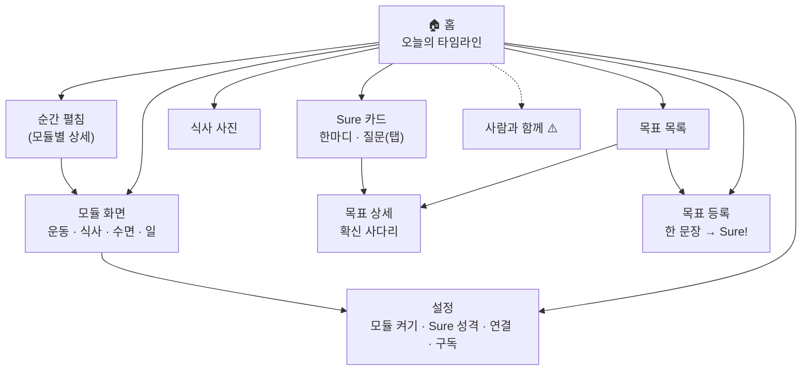
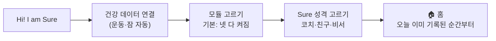
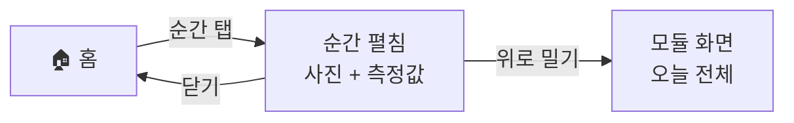
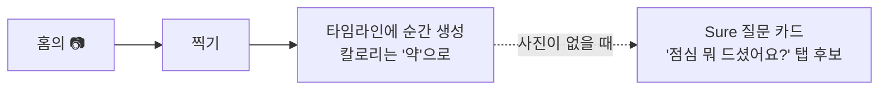
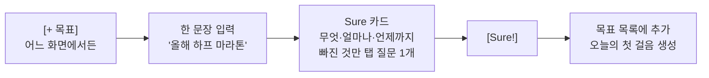
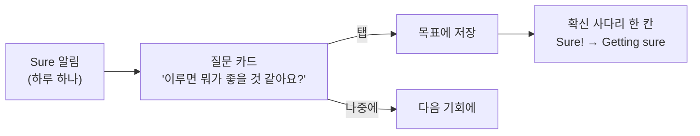
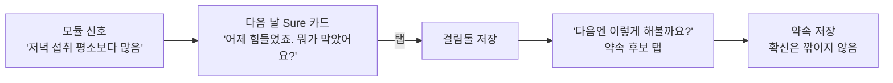
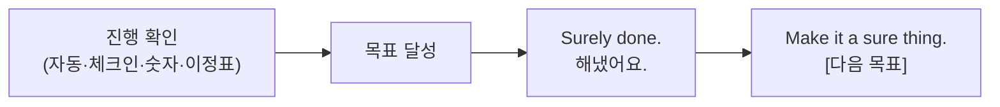

# UX 흐름 — 초안 v0

> 작성 2026-11-03. 표기: [결정] · [제안] · ⚠️ 아직 빈칸
> 지금까지의 결정만으로 그린 흐름. 모듈(식사·수면·일)과 Sure가 정해지면 다시 그린다.

---

## 0. 이 흐름이 따르는 결정

- **삶의 OS.** LIFE = OS, SURE = 코파일럿, 모듈 = 앱.
- **홈 = 오늘의 타임라인.** 네 모듈의 기록이 시간순 "순간"으로 놓인다. 아래 슬라이더로 지난 날.
- **오늘이 가장 중요하다.**
- **목표 없이도 굴러간다.** 목표는 문득 가볍게 등록하고, 등록은 무료.
- **목표는 모듈에 묶이지 않는다.** 진행 확인은 자동 · 체크인 · 숫자 입력 · 이정표.
- **Sure와 채팅은 없다.** Sure는 한마디, 알림, 탭으로 답하는 짧은 질문으로만 말한다.
- **아주 쉽게.** 기록은 자동 → 사진 → 탭 순.
- **기기**: 폰 · 워치 · 데스크톱(웹), 모두 같은 삶.

---

## 1. 화면 지도

| 화면 | 하는 일 | 상태 |
|---|---|---|
| **홈** | 오늘의 순간들이 세로로. 슬라이더로 날짜 이동. 목표 등록과 사진 버튼 | 방향 결정 |
| **순간 펼침** | 순간 하나가 화면 가득. 사진 위에 측정값이 계기판처럼 | 방향 결정 |
| **모듈 화면** | 오늘의 큰 숫자 + 작은 숫자 둘, 아래에 쌓인 것. 내 계기판 고르기 | 운동만 초안 |
| **목표 목록** | 진행 중 목표들. 오늘의 한두 개가 위, 나머지는 조용히 | 초안 |
| **목표 상세** | 해볼까 → 할 수 있어 → 할 거야 → 해냈어. 확신을 키운 것들 | 초안 |
| **목표 등록** | 한 문장 → Sure 카드 → [Sure!] | 초안 |
| **식사 사진** | 찍으면 끝. 순간이 타임라인에 생김 | 식사 모듈 기획 전 |
| **Sure 카드** | Sure가 먼저 건네는 한마디와 탭 질문. 채팅창 아님 | Sure 기획 전 |
| **설정** | 모듈 켜기/끄기, Sure 성격, 건강 데이터 연결, 구독 | 초안 |
| **사람과 함께** | ⚠️ 비어 있음 | 미정 |

---

## 2. 핵심 흐름

### F1. 처음 여는 날 [제안]

목표를 묻지 않는다. 앱이 바로 오늘을 비추기 시작하는 게 목표.

- 건강 데이터를 연결하면 **오늘 아침 걸음이나 어젯밤 잠이 이미 타임라인에 있다.** 첫 화면부터 비어 있지 않다.
- 연결을 건너뛰어도 홈으로 간다.
- ⚠️ Sure 성격 고르기는 유료 기능으로 정해져 있음 → 첫날 고르게 할지, 구독 후에 할지.
- ⚠️ 기록이 하나도 없는 첫날 홈은 어떻게 보일지.

### F2. 보통의 하루 (창업자) [제안]

사용자가 앱을 거의 열지 않아도 타임라인이 채워진다.

| 시각 | 무슨 일 | 사용자 수고 | 타임라인 |
|---|---|---|---|
| 07:10 | 워치가 밤사이 잠을 기록 | 없음 | ◯ 잠 6시간 40분 |
| 07:40 | 출근 라이딩 자동 기록 | 없음 | ◯ 출근 라이딩 20.1km |
| 09:00 | 데스크톱에서 홈을 켜 둠 | 없음 | — |
| 12:30 | 점심 사진 한 장 | 사진 1장 | ◯ 점심 약 650kcal |
| 15:12 | 커피 마시다 목표 등록 (F5) | 한 문장 + 탭 | 목표 하나 추가 |
| 18:50 | 퇴근 라이딩 자동 기록 | 없음 | ◯ 퇴근 라이딩 20.1km |
| 19:30 | 저녁 사진이 없음 → Sure 질문 카드 | 탭 1번 | ◯ 저녁 |
| 22:00 | Sure의 하루 한마디 | 읽기 | — |

### F3. 순간 보기

### F4. 식사 기록 [제안, 식사 모듈 기획 전]

- ⚠️ 사진 칼로리 분석은 AI라 유료인지 미정. 무료라면 사진만 남고 칼로리는 비어 있는가?

### F5. 목표 등록 — 커피 마시다 문득 [제안]

- 문장 입력은 채팅이 아니다. 메모 한 줄을 남기는 것에 가깝다. Sure는 카드로만 답한다.
- ⚠️ "채팅 없음" 결정과 경계 확인 필요: 한 문장 입력을 허용할지, 처음부터 탭 후보만 줄지.

### F6. 목표 키우기 — Sure가 먼저 묻는다 [제안]

### F7. 흔들린 날 [제안]

### F8. 목표를 이룬 날

- 놓아주기·쉬어가기도 같은 자리에서. 놓아준 목표에도 쌓인 성취는 남는다.

### F9. 지난 날 보기

- 홈 아래 슬라이더를 넘기면 어제, 그제의 타임라인.
- 지난 날은 바꿀 수 없고 볼 수만 있다. 오늘이 가장 크게. [제안]

### F10. 기기별 들어오는 곳 [제안]

| 기기 | 주로 하는 흐름 |
|---|---|
| 워치 | 운동 시작·자동 기록, Sure 한마디 알림, 탭 질문 답하기, 체크인 |
| 폰 | 홈, 식사 사진, 목표 등록, 순간 펼침 |
| 데스크톱 | 근무 중 홈을 켜 둠, 한 줄 목표 등록, 체크인, 주간 돌아보기 |

---

## 3. 이 흐름에서 드러난 빈칸

1. ⚠️ **Sure의 한마디는 홈 어디에 놓이나.** 타임라인 맨 위? 순간들 사이? 따로 알림으로만?
2. ⚠️ **목표는 홈 어디에 보이나.** 타임라인 안에 섞이나, 위에 따로 두나, 다른 화면으로 가나.
3. ⚠️ **잘 산 하루는 남는가.** 홈이 오늘의 타임라인이 되면서 하루 단위 지표가 필요한지 다시 볼 것.
4. ⚠️ **사람과 함께는 어느 화면인가.**
5. ⚠️ **유료 경계가 흐름 어디서 나타나나.** Sure 카드를 무료 사용자가 볼 때 어떻게 되나.
6. ⚠️ **한 문장 입력과 "채팅 없음"의 경계.**
7. ⚠️ **식사·수면·일 모듈의 순간과 화면.** 모듈 기획 뒤에 채움.
